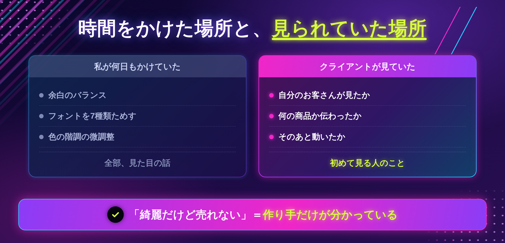
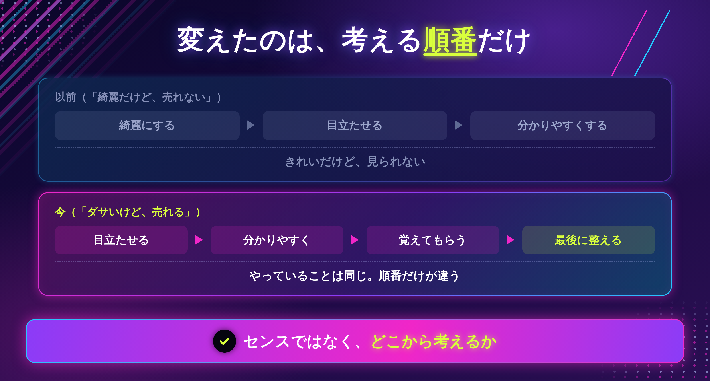
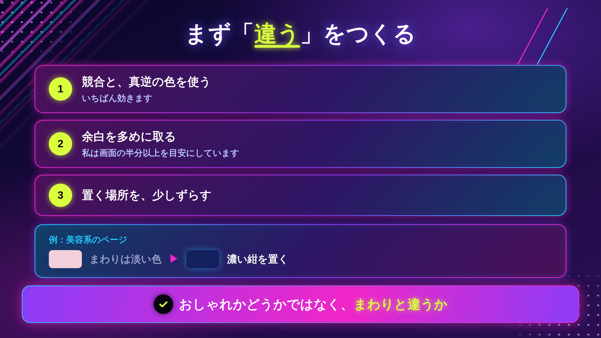
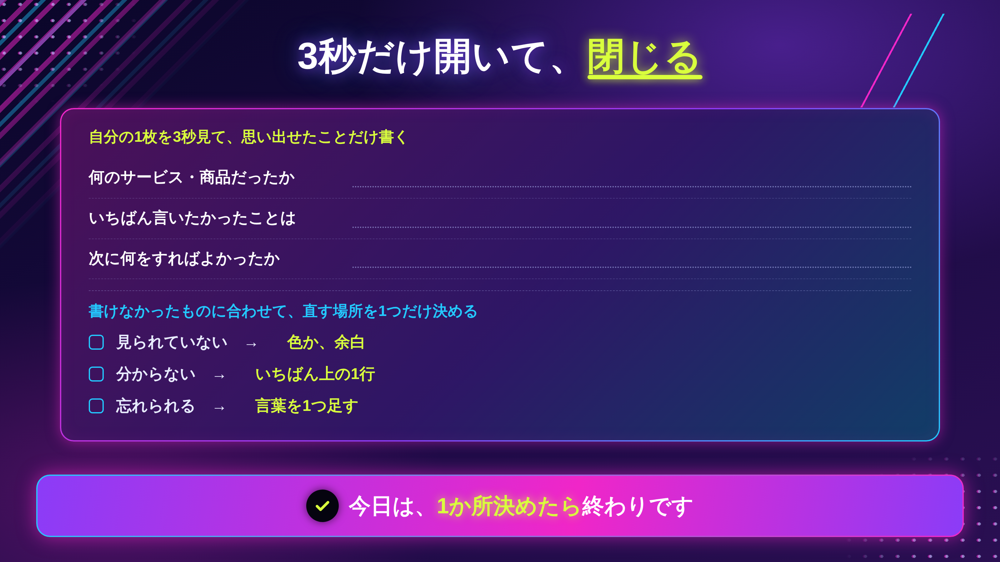

「このデザイン、綺麗なんだけど……売れないんだよね」

納品のあとに言われました。

何を直せばいいのか、分かりませんでした。綺麗だと言われています。でも、だめだと言われています。

「もっと綺麗にします」と答えるしかありませんでした。それが見当違いだと気づくまで、かなりかかりました。

当時の私にとって、デザインの良し悪しは見た目の良し悪しとほぼ同じ意味でした。

そのあと、そのクライアントからの依頼は**半年ほど止まりました。**

## 私が時間をかけていたのは、誰にも頼まれていない場所でした

当時、1枚のLPに何日もかけていました。やっていたのは、だいたいこういうことです。

```
余白のバランスを何度も調整する
フォントを7種類ためして1つに決める
色の階調を少しずつ変えて見比べる
写真の明るさを微調整する
```

全部、**見た目**の話です。

丁寧にやっていたつもりでした。実際、丁寧ではあったと思います。

ただ、クライアントがお金を払っていたのは、**見た目**に対してではありませんでした。

### 相手が払っていたのは、別のことへの対価でした

発注した人が見ているのは、デザインそのものではありません。

**そのデザインを見た、自分のお客さんがどう動いたか**です。

私はその人の商品を、1日で何回も見ていました。でも、その商品を**初めて見る人**のことは、ほとんど考えていませんでした。

作っているあいだ、私はいちばんその商品に詳しい人になっています。だから、分かりにくさに気づけません。

「綺麗だけど売れない」は、**作り手だけが分かっている状態**のことだったんだと思います。



## 何年かあとに、逆のことを言われました

「あなたのデザイン、ダサいけど売れるね」

正直、最初は複雑でした。ダサい、と言われているので。

でも今は、**いちばんうれしい言葉**です。

センスが上がったわけではありません。今も、おしゃれなものを作るのは得意ではないと思っています。

変えたのは1つだけです。**考える順番**を変えました。

### 以前と、今の順番

```
×  綺麗にする　→　目立たせる　→　分かりやすくする
○  目立たせる　→　分かりやすくする　→　覚えてもらう　→　最後に整える
```

やっていることは同じです。順番だけが違います。

そして、**最初にどこから考えるかで、出来上がるものが変わりました。**

綺麗から入ると、きれいだけど誰にも見られないものができます。実際、そうなっていました。

順番を変えてから、作業時間はむしろ減りました。最後に整えるぶんだけ時間をかければよくなったからです。



### 今日、無料でできること

自分がいちばん最近つくったものを、1つ開いてください。

そして、**3秒だけ見て閉じます。**

そのあと、何が記憶に残っているかを書き出します。

```
何のサービスか、分かったか
いちばん言いたいことは何だったか
次に何をすればいいか、分かったか
```

3つとも出てこなければ、綺麗さの問題ではありません。直す場所は、別のところにあります。

自分の作ったものでやると、たいてい「分かっているつもり」になります。それでも構いません。**出てこなかった項目があったという事実**だけ、覚えておいてください。

> 今日はここまでで大丈夫です。作り直さなくていいです。

ここまでが、順番を間違えていた、という話です。

ただ、「目立たせる」と言われても、何をすればいいのか分かりにくいと思います。私も、派手にすることだと思っていました。

この先に書くのは、**3つの順番それぞれで、具体的に何をするか**と、自分ではできない確認のやり方、そして15分の手順です。

## ①目立つ ― いちばん簡単で、いちばん飛ばされます

最初にやるのは、見てもらうことです。

当たり前に聞こえますが、ここを飛ばして「分かりやすさ」から入る人がとても多いです。私もそうでした。

分かりやすくても、**見られなければ0**です。

### やっているのは、3つだけです

```
1｜競合と、真逆の色を使う
2｜余白を多めに取る（私は画面の半分以上を目安にしています）
3｜置く場所を、少しずらす
```

1がいちばん効きます。

たとえば美容系のページは、淡いピンクやベージュが多いです。そこに**濃い紺**を置くと、スクロールしている指が止まります。

色がおしゃれかどうかではなく、**まわりと違うかどうか**です。

### 競合を3つ、先に見てください

自分の好みから色を決めると、だいたい周りと同じになります。好みは、同じ業界を見ているうちに似てくるからです。

先に競合を3つ開いて、共通している色をメモしてください。**その色を避ける**のが、いちばん早い方法です。



## ②理解される ― 3秒で分からないものは、それ以降見られません

目立ったあと、見た人は数秒で判断します。

私が目安にしているのは**3秒**です。厳密な数字ではありませんが、これくらいで考えておくと間違えにくいです。

3秒で、この3つが分かるかどうかを見ます。

```
1｜何のサービス・商品なのか
2｜いちばん伝えたい価値は何か
3｜次に何をすればいいのか
```

### 自分では、確認できません

ここが難しいところです。

自分は何時間も見ているので、3秒で分かるかどうかの判断ができません。知っていることを「分かる」と錯覚します。

やり方は2つです。

```
・その商材を知らない人に見せて、3秒で閉じてもらう
・一晩置いてから、翌朝いちばんに3秒だけ開く
```

人に見せるときは、感想を聞かないでください。「どう思う？」ではなく、**「何のサービスだった？」**と聞きます。

感想を聞くと、相手は気をつかって綺麗さの話をします。

## ③記憶に残る ― ここがいちばん難しいです

見られて、分かった。それでもすぐ忘れられます。

残りやすいのは、だいたいこの3つです。

```
・意外な組み合わせ
・感情が動いた言葉
・繰り返し目に入る要素
```

私が1枚に入れるのは、**意外な組み合わせを1つ、感情に触れる言葉を1つ、色は全体で統一**。これだけです。

### 例

高級な和菓子屋さんなら、ふつうは「伝統」を前に出します。

そこで**「革新」**を前に出すと、少し違和感が生まれます。その違和感が、記憶に残ります。

ただし、**①と②が済んでいることが前提**です。見られていないもの、分からないものを覚えてもらうことはできません。

## 順番を逆にすると、何が起きるか

3つとも、言われてみれば当たり前のことです。大事なのは中身より**順番**でした。

```
綺麗から入る　　　→　美しいけれど、見られない
記憶から入る　　　→　奇をてらっただけになる
分かりやすさから　→　整っているが、埋もれる
```

私がやっていたのは、1番目です。

そして、**整えるのは最後で間に合います。** ①②③が済んだあとに整えると、同じ作業でも結果が変わりました。

## 実際にやってみる（15分）



### ステップ1｜競合を3つ開いて、共通の色をメモする（5分）

業界は何でも構いません。自分が次に作るもの、もしくは直近で作ったものと同じ業界にしてください。

共通している色が2つくらい見つかります。それが**避ける色**です。

### ステップ2｜自分の1枚で、3秒テストをする（5分）

一晩置いたものがあれば、それを使ってください。なければ、今あるものでやります。

3秒開いて閉じて、「何のサービスだったか」を書きます。**書けなかったら、②がまだです。**

### ステップ3｜直す場所を、1か所だけ決める（5分）

全部直さないでください。

```
見られていない　→　色か、余白
分からない　　　→　いちばん上の1行
忘れられる　　　→　言葉を1つ足す
```

今日は、どこを直すかを決めるところまでで終わりです。

### つまずいたときの、3つの分かれ道

**① 競合と違う色にすると、ダサくなる気がする**

なります。最初はそう見えます。ただ、それは**見慣れていないだけ**かもしれません。1日置いて、もう一度見てください。それでも違和感が残るなら、彩度を少し落とします。

**② 3秒テストを頼める人がいない**

スマホで撮って、3日後に見てください。他人に近い目で見られます。家族でも構いません。デザインが分かる人である必要はありません。むしろ、分からない人のほうが正確です。

**③ クライアントに「もっと綺麗に」と言われる**

直してください。そのうえで、**なぜ今の形にしたかを1行添えます。** 「ここは、スマホで最初に見える部分なので、文字を大きくしています」。理由が分かると、話が綺麗さの話から離れます。

> 今日は、1か所決めたら終わりで大丈夫です。

## おわりに

「綺麗だけど、売れないんだよね」と言われたとき、私は綺麗さが足りないのだと思いました。

だから、もっと綺麗にしようとしました。そして半年、依頼が止まりました。

足りなかったのは、綺麗さではありませんでした。**考える順番**でした。

今は「ダサいけど売れるね」と言われます。ほめ言葉として受け取っています。

センスが人並みでも、順番は変えられます。順番なら、今日から変えられます。

---

「自分の1枚を、どこから直せばいいのか分からない」という方へ。

LINEで、個別ロードマップ作成会をご案内しています。実際のデザインを一緒に見ながら、直す1か所を決めます。よかったら覗いてみてください。
