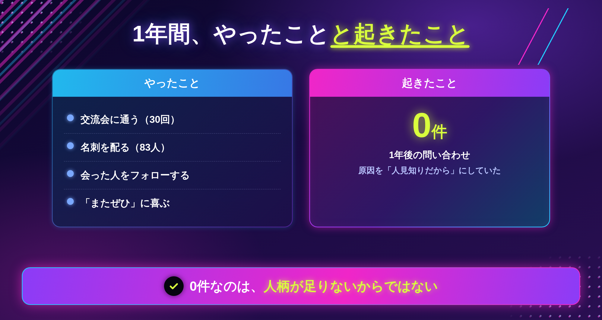
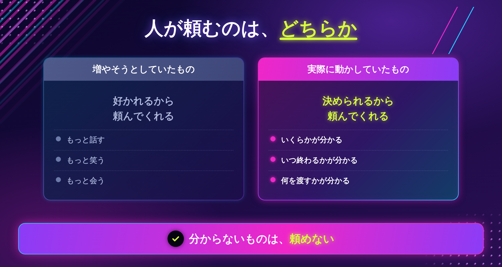
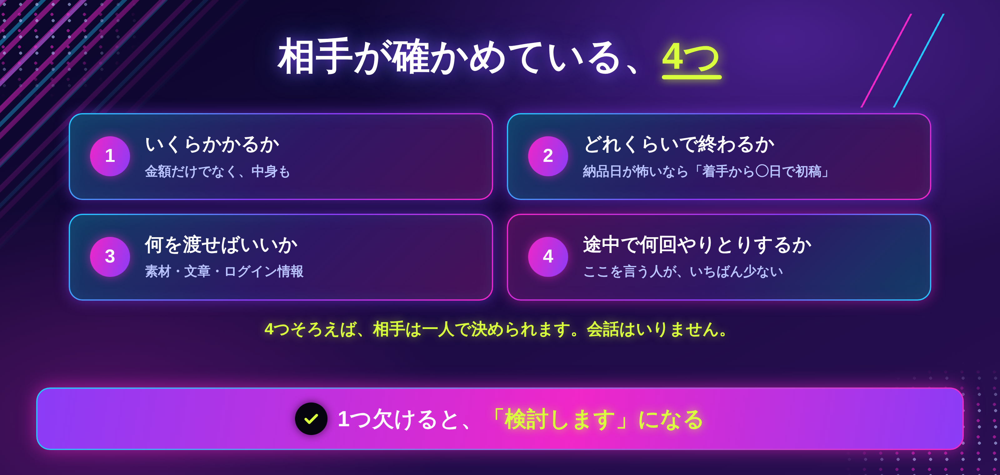
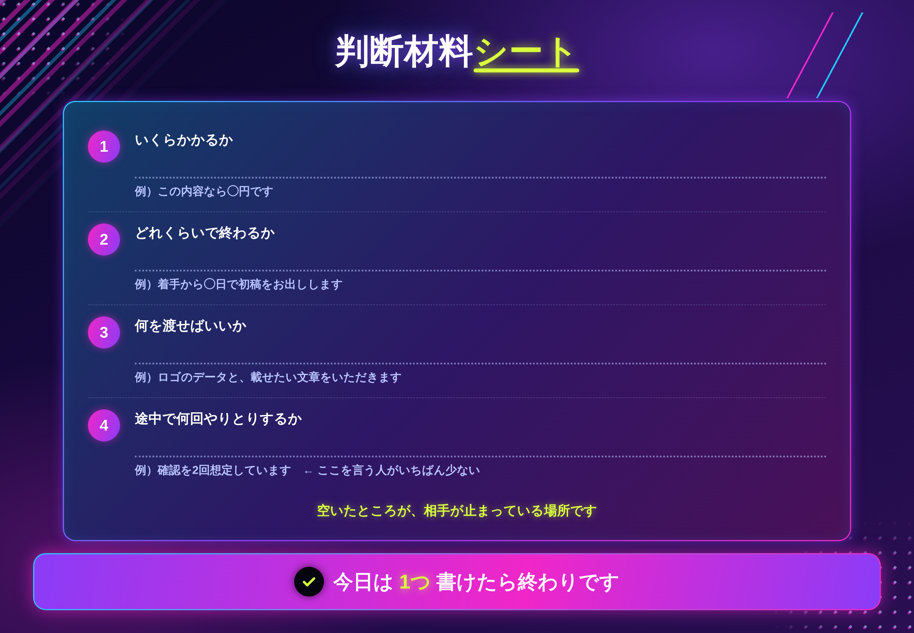

「営業、ぜんぜんできないんです」

相談でいちばん多く聞く言葉です。6年前の私も、同じことを言っていました。

人見知りで、雑談が続かない。会ったあとに「もっと話せばよかった」と反省する。そういうタイプです。

だから、苦手を埋めようとしました。

交流会に**30回**行きました。名刺交換を**83人**としました。

1年後、そこからの問い合わせは**0件**でした。

当時の私は、こう結論づけました。「やっぱり、私は人と話すのが向いていないんだ」と。

**それが、6年間まちがえていた**ところでした。

この記事に書くのは、**なぜ人柄を増やしても問い合わせが増えないのか**と、話さずに依頼される方法です。

性格を直す話ではありません。むしろ、**直さなくていい**という話です。

## 人柄を増やしても、問い合わせは増えませんでした

### やったことと、起きたこと

当時やっていたことを、そのまま書きます。

- 交流会に通う（30回）
- 名刺を配る（83人）
- 会った人のSNSをフォローする
- 「またぜひ」と言われたら喜ぶ

1年続けました。楽しくなかったわけではありません。でも、**問い合わせは0件**でした。

### 原因を「性格」にしていました

ゼロだった理由を、私はずっと自分の性格に置いていました。

「話が面白くないから」
「印象に残らないから」
「あの人みたいに明るくないから」

だから、次はもっと話そうとしました。もっと笑おうとしました。**そして、もっと疲れました。**

今から見ると、原因の置き場所が間違っていました。問題は性格ではなく、**相手が私に頼めなかった**ことでした。

> まずここだけ持ち帰ってください。**0件なのは、人柄が足りないからではありません。**



## 仕事が途切れない人は、おしゃべりではありませんでした

ある時期、仕事が途切れていない人を10人ほど見ていて、気づいたことがあります。

**その人たちも、別におしゃべりではありませんでした。**

むしろ、口数は少ないほうでした。交流会にもあまり行っていません。私より話さない人さえいました。

それなのに、依頼が途切れない。

### 違っていたのは、話す量ではありませんでした

何度か観察して、ようやく分かりました。

その人たちは、**相手が「決める」ために必要なものを、先に渡していました。**

```
人は、好かれたから頼むのではありません。
決められるから頼みます。
```

ここを逆に理解していました。私は「好かれる量」を増やそうとして、「決められる状態」を一度も作っていませんでした。

### 名刺を83枚配っても、ゼロだった理由

名刺で伝わるのは、名前と肩書きだけです。

渡された側は、あとから思い出しても**何も決められません。** いくらかかるのか、どれくらいで終わるのか、何を渡せばいいのか、分からないからです。

分からないものは、頼めません。だから連絡が来ません。

**私が83回渡していたのは、判断材料ではなく、自己紹介でした。**

> 今日のゴールは、「決められるか」で自分を見直すところまでで十分です。



ここまでが、何が起きていたかです。

では、相手は何がそろえば「決められる」のか。そして、話すのが苦手なままで、それをどう渡すのか。

この先に書くのは、**人が頼むときに頭の中で確かめている4つ**と、「返信が遅い」で切られた私が「遅いほうが助かる」と言われるようになった理由、そして15分の手順です。

## 人が頼むときに、確かめている4つ

相手が依頼を決めるとき、頭の中で確かめているのは、だいたいこの4つです。

```
① いくらかかるか
② どれくらいで終わるか
③ 何を渡せばいいか
④ 途中で何回やりとりするか
```

この4つが先に分かっていれば、相手は**一人で決められます。** 会話はいりません。

逆に、どれか1つでも欠けていると、相手は決められずに止まります。そして、たいてい「検討します」になります。

### 「検討します」は、断りではないことがあります

私はずっと、「検討します」を断りだと思っていました。

でも今は、**まだ決められていないだけ**のことが多いと思っています。4つのうちどれかが足りていない。そして、足りないものを聞き返すのは、相手にとって手間です。

だから、そのまま消えます。



## 「返信が遅い」で切られた私が、言われた言葉

5年前、私は「返信が遅い」という理由で取引を切られています。

ところが最近、別のクライアントにこう言われました。

「返信遅いですよね。でも、そのほうが助かってます」

意味が分からなくて、理由を聞きました。返ってきたのは、こうでした。

**「一回で話が進むからです」**

### 何が変わっていたか

変わったのは、返信の速さではありません。**返信の中身**でした。

以前の私は、聞かれたことにだけ答えていました。「はい、できます」「3日くらいです」。速いけれど、相手は次の質問をしなければいけません。

今は、1回の返信に**4つをまとめて**入れます。

```
・この内容なら◯円です
・着手から◯日で初稿をお出しします
・いただきたいのは、ロゴのデータと、載せたい文章です
・やりとりは、確認を2回を想定しています
```

遅くなっても、**相手はこれ1通で決められます。**

速さで勝てないなら、**回数で勝てばいい**。これは、話すのが苦手な人ほど向いているやり方です。

## 陰キャのままで、大丈夫な理由

ここまで読んで、気づいた方もいると思います。

**4つの判断材料は、全部「書いて渡せるもの」です。**

会話で伝える必要がありません。その場の空気を読む必要も、面白いことを言う必要もありません。

むしろ、

- 一度にまとめて考えるのが得意
- 文章のほうが落ち着いて書ける
- 言い忘れが怖いので、先に全部書き出す

こういう人のほうが、4つをきれいにそろえられます。**内向的であることが、そのまま有利になる場所**です。

私は今でもビビりですし、雑談も続きません。交流会にも行っていません。それでも仕事は途切れていません。

変えたのは性格ではなく、**渡すものだけ**でした。

> 全部そろえなくて大丈夫です。今は1つ書ければ十分です。

## 実際にやってみる（15分）

### ステップ1｜直近の1件を思い出す（3分）

これから来る仕事ではなく、**すでに終わった1件**で書きます。そのほうが具体的に書けます。

### ステップ2｜4つを埋める（10分）



全部埋まらなくて構いません。**空いたところが、相手が決められずに止まっている場所**です。

### ステップ3｜次の返信に、1つ足す（2分）

次に問い合わせが来たとき、いつもの返信に**4つのうち1つだけ**足してみてください。

いちばん効きやすいのは**④（何回やりとりするか）**です。ここを言っている人が、ほとんどいないからです。

### 書けないときの、3つの分かれ道

**①「いくらか」が書けない**

金額が決まっていないのではなく、**その金額の中身を説明できない**状態かもしれません。この場合は、金額から先に決めてください。

**②「どれくらいで終わるか」が怖くて書けない**

遅れたら困る、と思って書けないことがあります。その場合は、納品日ではなく**「着手から◯日で初稿」**と書いてください。全部を約束しなくていいです。

**③ 4つとも書けて、それでも反応がない**

渡す**場所**の問題かもしれません。見積もりの中にだけ書いていて、プロフィールや問い合わせページに一度も出していない、というケースがよくあります。

> 今日は1つ書けたら終わりで大丈夫です。4つそろえなくていいです。

## おわりに

交流会に30回行って、名刺を83枚配って、問い合わせは0件でした。

あのとき私が増やそうとしていたのは、**好かれる量**でした。でも相手が止まっていたのは、そこではありませんでした。

**決められなかった**だけです。

営業が苦手だと感じているなら、話す回数を増やす前に、自分が渡しているものを見てみてください。

名刺と自己紹介しか渡していないなら、**まだ一度も営業していない**のかもしれません。私がそうでした。

---

「自分の場合、何を渡せばいいのか分からない」という方へ。

LINEで、個別ロードマップ作成会をご案内しています。今の問い合わせのやりとりを一緒に見ながら、足りない1つを決めます。よかったら覗いてみてください。
