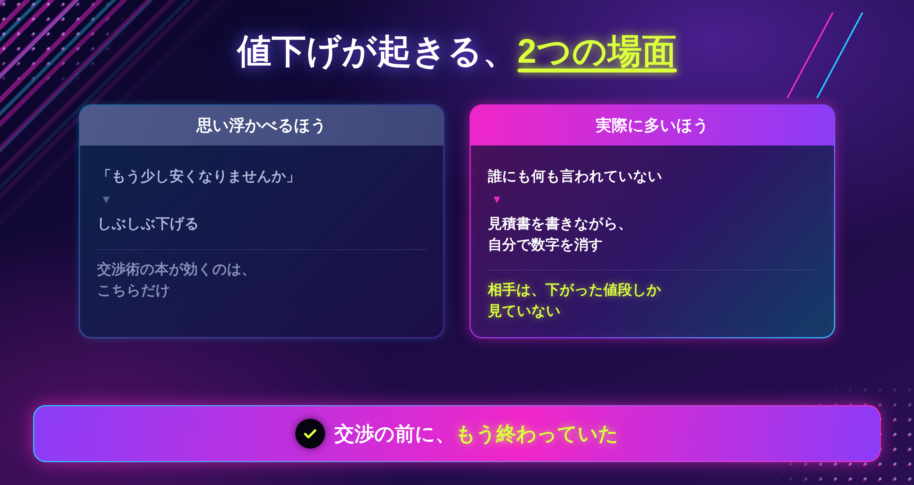
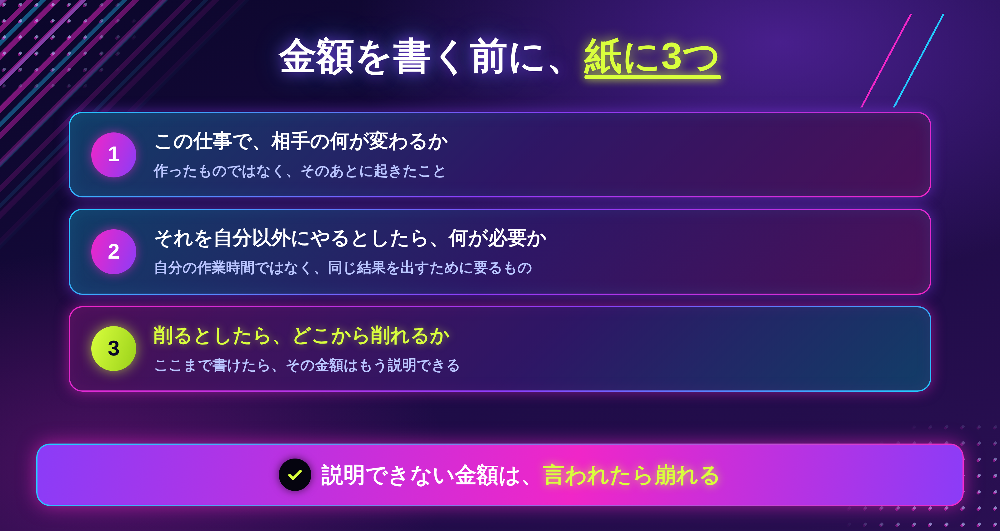
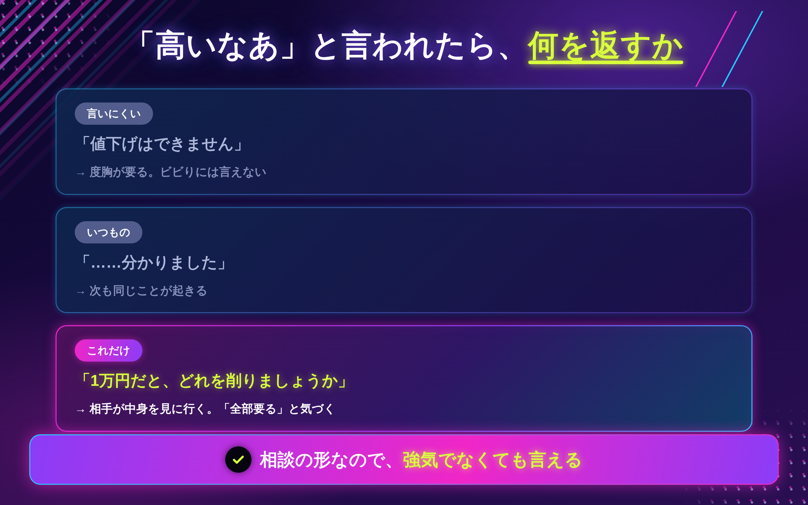
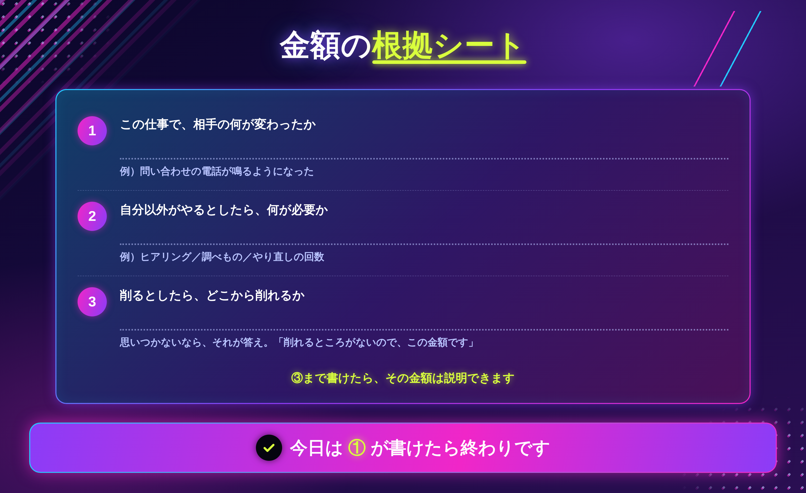

「で、おいくらですか」

この一言が、ずっと怖かったです。

6年前、私は見積書を送る前に、必ず金額を下げていました。相手に言われる前に、です。

3万円と書いて、消して、2万円にする。2万円と書いて、消して、1万5千円にする。

「高いと思われたらどうしよう」
「それで嫌われたら、次がない」

そうやって受け続けた結果、**2年間、時給300円**で働いていました。

当時の私は、自分のことを「買い叩かれている人」だと思っていました。値切るクライアントが悪いのだと。

でも、あとから過去の案件を並べて気づきました。**値切られた回数より、言われる前に自分で下げた回数のほうが、ずっと多かった**んです。

この記事に書くのは、**なぜ自分から下げてしまうのか**と、金額の決め方です。

高く売る話ではありません。**自分で決められるようになる**話です。

## 値下げは、2つの場面で起きています

### 言われて下げるより、先に下げている

値下げというと、交渉の場面を思い浮かべます。「もう少し安くなりませんか」と言われて、しぶしぶ下げる場面です。

でも実際に多いのは、**誰にも何も言われていないのに、自分で下げている**ほうでした。

- 見積書を書きながら、金額を書き直す
- 「このくらいなら通るかな」で決める
- 相手の予算を想像して、先に合わせる

ここには交渉がありません。**相手は、下がった値段しか見ていない**んです。

### だから、交渉術を覚えても変わりません

私は当時、断り方や交渉の本を読んでいました。でも、まったく効きませんでした。

当たり前です。**交渉の前に終わっていた**からです。



## 怖かったのは、金額ではありませんでした

### 3万円の中身を、自分で言えなかった

なぜ先に下げるのか。しばらく分かりませんでした。

はっきりしたのは、ある打ち合わせでこう聞かれたときです。

「この3万円って、何の金額ですか」

**答えられませんでした。**

相場を見て、似たような人の金額を見て、「このくらいかな」で決めていたからです。中身を自分で説明したことが、一度もなかった。

説明できない金額は、**言われたら崩れます。** 崩れるのが怖いから、先に下げる。そういう順番でした。

怖かったのは金額ではなく、**その金額の理由を、自分が持っていないこと**でした。

### 金額を決める前に、紙に3つ書く

今は、金額を書く前にこれを書きます。

```
① この仕事で、相手の何が変わるか
② それを自分以外にやるとしたら、何が必要か
③ 削るとしたら、どこから削れるか
```

**3つ目まで書けるかどうか**が分かれ目です。

③が書けるということは、その金額の中身を自分で分解できているということです。分解できていれば、「高い」と言われても崩れません。

> 今日のゴールは、直近の1件について①を書くところまでで十分です。



ここまでが、なぜ自分から下げてしまうのかです。

では、実際にいくらにすればいいのか。上げたら断られるのではないか。

この先に書くのは、**値段を上げたら断られなくなった話**と、「高いなあ」と言われたときに返す一言、そして金額を自分で決めるための15分の手順です。

## 値段を上げたら、断られなくなりました

6年前、ロゴの金額を **1万円から5万円**に変えました。

きっかけは、クライアントからの一言です。

「安すぎませんか」

褒められたのではありません。**心配されていました。**

その方はこう続けました。「この値段だと、途中で続かなくなる人が多いんです。最後まで付き合ってもらえるか分からないので」

### 安さは、安心ではありませんでした

私はずっと、安いほうが選ばれると思っていました。

でも相手から見ると、安い金額は**「この人は長く続かないかもしれない」という不安材料**になることがあります。

- 途中で投げ出されないか
- 雑に扱われないか
- あとから追加で請求されないか

値段を上げてから、この手の質問をされることが減りました。**金額そのものが、説明になっていた**んです。

### もちろん、全員が残ったわけではありません

上げたあと、離れた方もいます。それは事実です。

ただ、離れたのは**金額だけで選んでいた方**でした。そして、その方々との仕事は、たいてい修正が多くて長引いていました。

残った方との仕事のほうが、結果的に早く終わりました。

## 「高いなあ」と言われたときに返す一言

値段を上げても、交渉はあります。そのときに使っている言葉があります。

```
「1万円だと、どれを削りましょうか」
```

これだけです。

### なぜ、これが効くのか

「できません」でも「分かりました」でもありません。**一緒に考えよう、という形**にしています。

そして、この質問をすると、相手は**中身を見に行きます。**

値下げを求める方は、たいてい**何が含まれているかを知りません。** 金額だけを見て「高い」と言っています。

削るものを探しはじめると、「これは要る」「これも要る」と気づきます。そして、こう返ってくることがあります。

「……じゃあ、このままでお願いします」

### 自信がなくても言えます

この言葉のいいところは、**強気である必要がない**ことです。

「値下げはできません」と言うには度胸が要ります。でも「どれを削りましょうか」は、相談の形なので言えます。

私は今でもビビりですが、これは言えます。



> まずは1案件だけで大丈夫です。次に言われたときに、この一言を出してみてください。

## 実際に決める（15分）

### ステップ1｜直近の1件を思い出す（3分）

これから決める金額ではなく、**すでに終わった1件**を使います。そのほうが正確に書けます。

### ステップ2｜3つを書く（10分）



①から順に書いてください。③から書こうとすると、たいてい詰まります。

### ステップ3｜③が書けたか確認する（2分）

③が書けていれば、その金額はもう説明できます。

書けていなければ、まだ**相場で決めている**状態です。悪いことではありません。私も6年そうでした。ただ、そこが「言われたら崩れる」場所です。

### 書けないときの、3つの分かれ道

**①「相手の何が変わるか」が出てこない**

作ったものではなく、**その後に起きたこと**を思い出してください。「チラシを作った」ではなく「問い合わせの電話が鳴るようになった」。思い出せなければ、次の納品のときに聞いてみてください。

**②「自分以外がやるとしたら」が想像できない**

自分の作業時間ではなく、**知らない人が同じ結果を出すために必要なもの**を書きます。ヒアリング、調べもの、やり直しの回数。ここが金額の中身です。

**③ 削れるものが思いつかない**

全部必要だと思うなら、それが答えです。**そのまま相手に言ってください。** 「削れるところがないので、この金額です」は、十分な説明になります。

> 今日は①が書けたら終わりで大丈夫です。3つそろえなくていいです。

## おわりに

2年間、時給300円で働いていました。

当時の私は、値切る相手が悪いと思っていました。でも並べ直してみたら、**下げていたのは自分**でした。

金額を上げる勇気が要る、という話をよく聞きます。でも私の場合、必要だったのは勇気ではありませんでした。

**その金額の中身を、自分が知っているかどうか**だけでした。

もし今、見積書を書きながら数字を消しているなら。消す前に、紙に3つ書いてみてください。

たぶん、消さなくてよくなります。

---

「自分の場合、いくらにすればいいのか分からない」という方へ。

LINEで、個別ロードマップ作成会をご案内しています。今の金額の中身を一緒に見ながら、次の1件の出し方を決めます。よかったら覗いてみてください。
