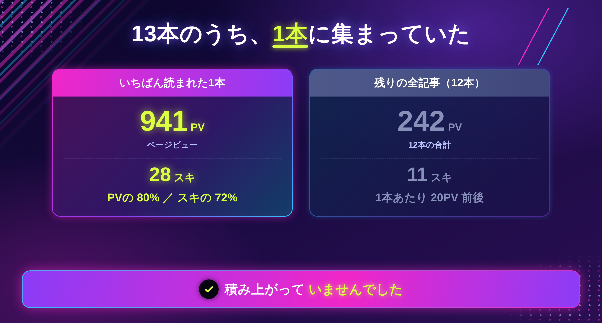
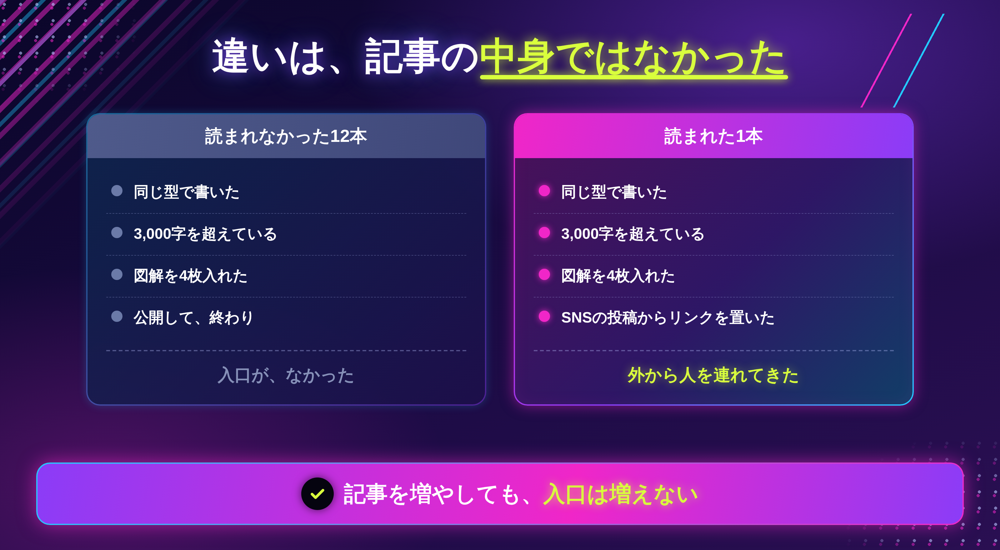
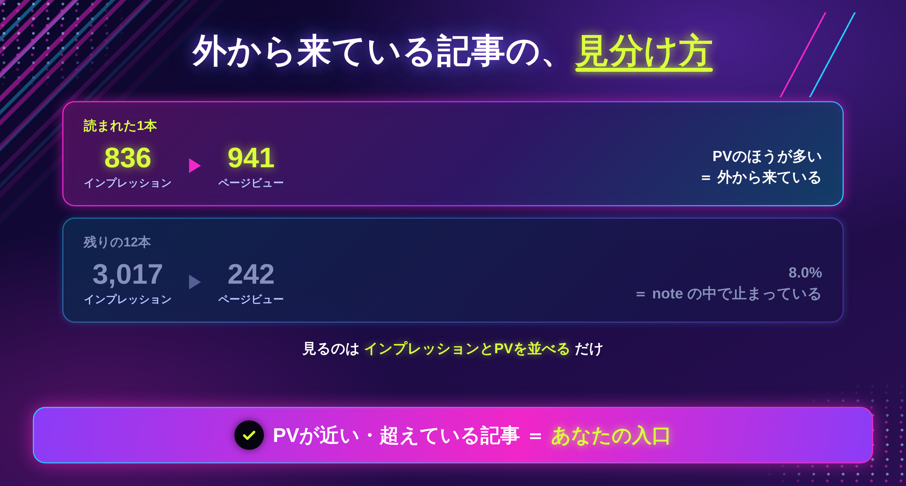
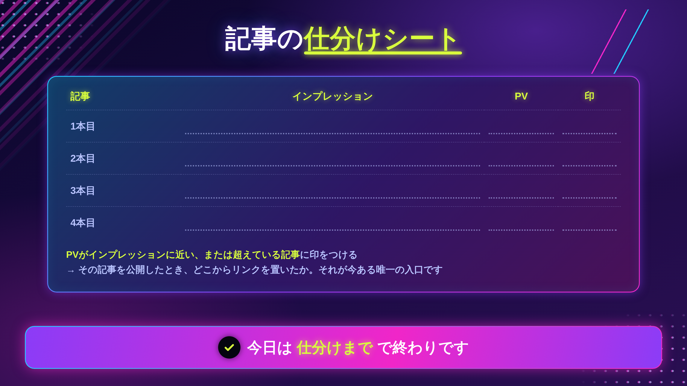

「毎日書いているのに、読まれないんです」

先月から、noteを毎日1本のペースで出していました。ダッシュボードに数字が並んでいるのは13本です。

結果を見て、手が止まりました。

**PVの8割が、1本の記事に集まっていました。**

残りの12本は、ほとんど読まれていません。1本あたり1〜20PVです。公開した翌日に**1PV**だった記事もあります。

当時の私は、「まだ本数が足りないんだ」と思っていました。もっと書けば、どこかで積み上がるはずだと。

でも、数字を並べたら、**積み上がっていない**ことがはっきりしました。

この記事に書くのは、**13本分の数字をそのまま出して、読まれた1本と読まれなかった12本の違いを調べた結果**です。

もっと書きましょう、という話ではありません。むしろ、**本数は関係なかった**という話です。

## 13本分の数字を、そのまま出します

まず、28日間の合計です。

```
インプレッション　3,853
ページビュー　　　1,183
スキ　　　　　　　　 39
```

これを、記事ごとに分けます。

```
いちばん読まれた1本　　　PV 941　スキ 28
残りの全記事（12本）　　 PV 242　スキ 11
```

**PVの80%、スキの72%が、1本に集まっていました。**

### 読まれなかった記事は、本当に読まれていません

控えめに書くと嘘になるので、そのまま書きます。

```
PV 20　（公開から20日）
PV 16
PV 15
PV 14
PV  7
PV  6
PV  1　（公開の翌日）
```

丁寧に書いた記事です。図解も4枚ずつ入れました。文字数も3,000字を超えています。

でも、読まれていません。

> まずここだけ持ち帰ってください。**読まれないのは、記事の質の前に、別の理由があります。**



## 違いは、記事の中身ではありませんでした

読まれた1本と、読まれなかった12本を並べて見比べました。

書き方の型は同じです。文字数もほぼ同じ。図解の枚数も同じ。テーマの深さも、自分では差をつけたつもりがありません。

### 違ったのは、たった1つでした

**読まれた1本だけが、noteの外から人を連れてきていました。**

その記事は、Threadsで15万回見られた投稿の続きとして書いたものです。投稿の最後にリンクを置きました。

残りの12本には、それがありませんでした。書いて、公開して、それで終わりです。

### 記事を増やしても、入口は増えません

これが、私が13本かけて気づかなかったことでした。

記事を1本増やすと、**noteの中にある棚が1つ増えます。** でも、お店に入ってくる人は増えません。

棚を13個に増やしても、入口が1つのままなら、来る人の数は変わらない。私がやっていたのは、**誰も入ってこないお店の中で、棚を増やし続けること**でした。

> 今日のゴールは、自分の記事を「**外から人を連れてきたか／こなかったか**」で分けるところまでで十分です。



ここまでが、13本分の数字を見て分かったことです。

では、どの記事が「外から人を連れてきた」のかを、どうやって見分けるのか。そして、毎日書くのをやめて、代わりに何をしたのか。

この先に書くのは、**自分の記事を1分で仕分ける方法**と、noteのインプレッションがほとんど役に立たなかった理由、そして15分の手順です。

## 外から来ている記事は、数字で見分けられます

見るのは、**インプレッションとPVを並べる**だけです。

noteのインプレッションは、**note の中で記事が表示された回数**です。おすすめ欄やタイムラインに出た回数、と考えると近いと思います。

対してPVは、実際に記事が開かれた回数です。

### PVがインプレッションを超えていたら、外から来ています

私の数字で見ると、こうなっていました。

```
読まれた1本　　インプレッション 836　→　PV 941
残りの12本　　インプレッション 3,017　→　PV 242
```

上の記事は、**表示された回数より、読まれた回数のほうが多い**んです。

note の中で見られた回数を超えているということは、その差は**外から来た人**ということになります。

### 残りの12本は、8%でした

下の行を割り算すると、**8.0%**です。

noteの中で3,017回表示されて、開かれたのは242回。

つまり、**noteの中で表示されても、ほとんど開かれていません。**



## note内で表示されても、クリックされません

さらに1本ずつ見ると、もっとはっきりします。

```
557回表示 →  16PV（2.9%）
339回表示 →  20PV（5.9%）
484回表示 →  30PV（6.2%）
 27回表示 →   1PV（3.7%）
```

数百回表示されても、開かれるのは数十回です。

### 「表示された」は、成果ではありませんでした

私はしばらく、インプレッションが増えると安心していました。「見られてはいるんだな」と。

でも、インプレッションは**こちらで動かせません。** noteのおすすめに出るかどうかは、こちらの仕事の外側にあります。

そして、出たとしても、開かれるのは数%です。

**動かせない数字を見て安心していた**のが、10本分の時間でした。

## 「毎日書く」で増えたもの、増えなかったもの

正直に書きます。

毎日書いて増えたのは、**記事の本数だけ**でした。

```
増えた　　　記事数
増えない　　PV
増えない　　スキ
増えない　　フォロワー
```

書くこと自体が無駄だったとは思っていません。書いたから、この数字が取れました。

ただ、**順番が逆**でした。

### 今は、順番を変えています

以前は、こうしていました。

```
noteを書く　→　公開する　→　終わり
```

今は、こうしています。

```
Threadsに書く　→　反応を見る　→　伸びたものだけnoteにする　→　投稿からリンクを置く
```

**先に外で人を集めてから、記事を書きます。** 書く本数は減りましたが、1本あたりの読まれ方が変わりました。

> 全部を変えなくて大丈夫です。次の1本だけ、先に外で出してみてください。

## 実際にやってみる（15分）

### ステップ1｜記事を仕分ける（10分）

ダッシュボードを開いて、記事ごとにインプレッションとPVを書き出します。



**PVがインプレッションに近い、または超えている記事**に印をつけてください。それが、外から人を連れてきた記事です。

### ステップ2｜印のついた記事を、1本だけ見る（3分）

その記事を公開したとき、**どこからリンクを置いたか**を思い出してください。

SNSの投稿か、プロフィールか、誰かの紹介か。その経路が、今あなたが持っている唯一の入口です。

### ステップ3｜次の1本の「入口」を先に決める（2分）

次に書く記事の**内容ではなく、どこから人を連れてくるか**を先に決めます。

決まっていないなら、その記事は**まだ書かないほうがいい**かもしれません。私の12本がそうでした。

### 印がつかなかったときの、3つの分かれ道

**①1本も印がつかない**

まだ入口がない状態です。記事を増やすより、**SNSの1投稿を伸ばすほうが先**です。本数は、そのあとで効いてきます。

**②印はついたが、その経路をもう使えない**

誰かの紹介や、単発の露出だったケースです。この場合は、**自分で繰り返せる経路**を1つ作ってください。毎日投稿でも、1本の固定投稿でも構いません。

**③インプレッションは多いのに、PVが低い**

タイトルで止まっています。本文を直す前に、**タイトルだけ**を見直してください。私の記事も、2.9%まで落ちているものがあります。

> 今日は、仕分けまでで終わりで大丈夫です。書き直さなくていいです。

## おわりに

13本書いて、PVの8割は1本に集まりました。

その1本だけが優れていたわけではありません。**その1本だけが、外から人を連れてきていた**だけです。

毎日書いていると、書いた量が積み上がっている気がします。私もそう思っていました。でも、入口がないまま書いた12本は、**棚に並んだだけ**でした。

もし今、「毎日書いているのに読まれない」と感じているなら、次の記事を書く前に、**インプレッションとPVを並べてみてください。**

たぶん、書く量の問題ではありません。

---

「自分の記事の、どこを直せばいいのか分からない」という方へ。

LINEで、個別ロードマップ作成会をご案内しています。実際の数字を一緒に見ながら、入口を1つ決めます。よかったら覗いてみてください。
