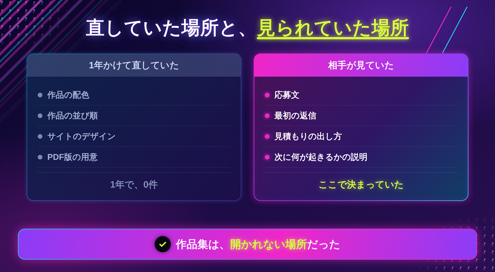
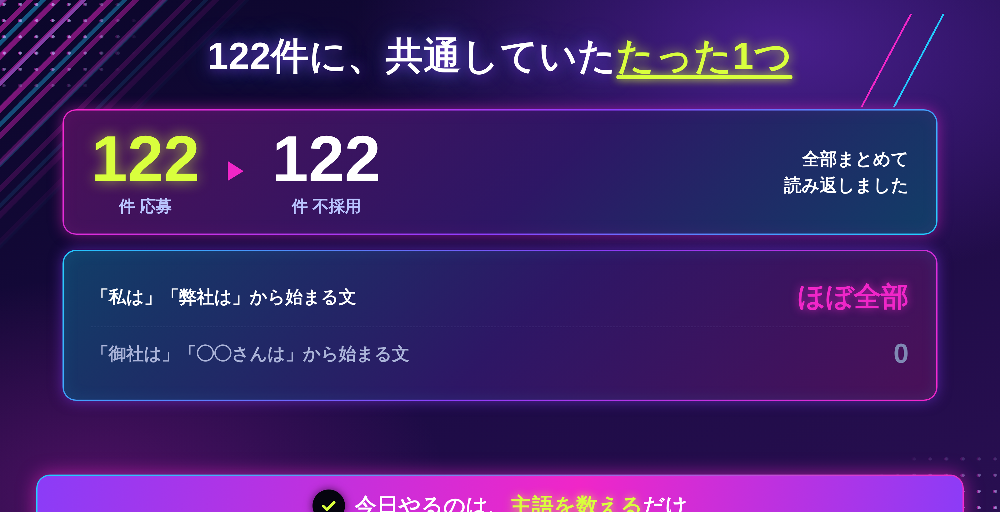
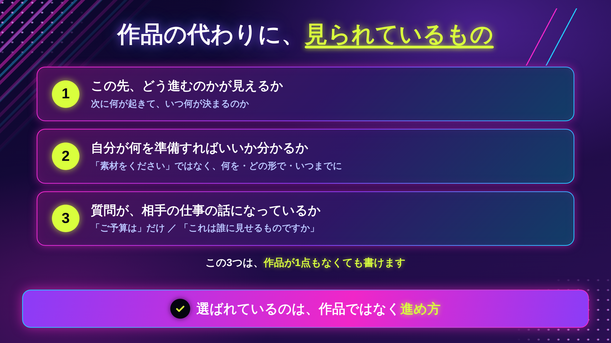
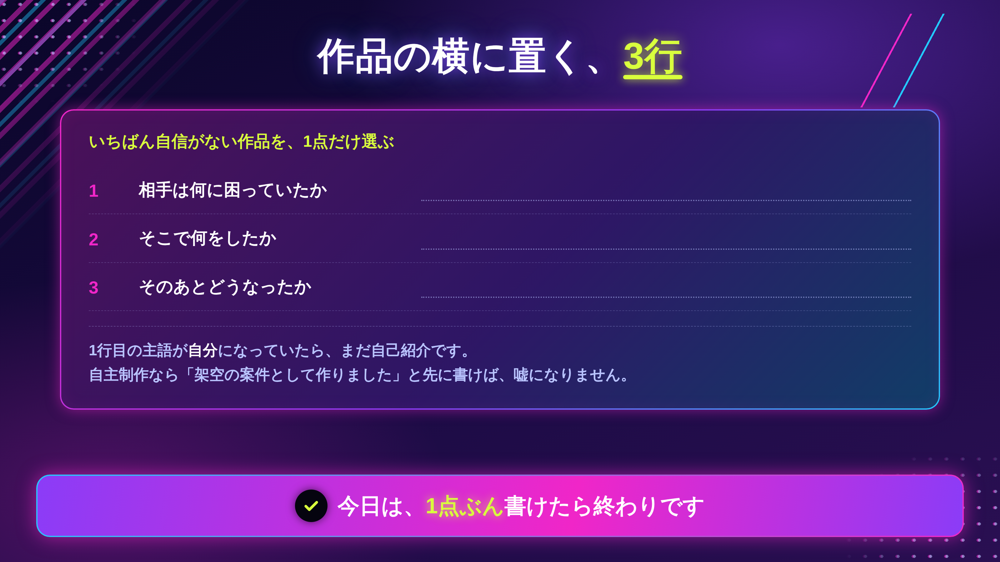

「ポートフォリオ？見てないですよ」

納品の直前に、そう言われました。

120万円かけて、スクールで作った作品集です。卒業してからも1年かけて直して、Webサイトにもまとめて、応募のたびにリンクを貼っていました。

その作品集は、一度も開かれていませんでした。

思い切って聞いてみました。**「じゃあ、何を見て私に決めたんですか」**

返ってきた答えに、作品の話はひとつも出てきませんでした。

当時の私は、仕事が来ない理由を「作品が弱いから」だと思っていました。だから直していました。配色を変えて、レイアウトを整えて、Webサイトにして、PDFも作って。

直す場所が、そもそも違っていたんです。

この記事に書くのは、**作品集を直す前に見るべき場所**と、作品が少ないうちに何を出すか、です。

「もっと良いものを作りましょう」という話ではありません。むしろ、**作る前にやることがあった**という話です。

## 1年かけて、見られない場所を直していました

スクールを卒業したあとの1年間、私の作業はほとんどこれでした。

```
作品を1点増やす
配色を見直す
並び順を入れ替える
サイトのデザインを変える
PDF版も用意する
```

毎週どこかを直していました。直すと、少し安心しました。「前より良くなった」と思えるからです。

その1年で決まった仕事は、**0件**です。

### 直していた場所と、見られていた場所

あとから分かったのは、単純なことでした。

私が1年かけて直していたのは、**相手が開かない場所**でした。

そして相手が見ていたのは、作品集ではなく、**そこに至るまでのやりとり**でした。応募文、最初の返信、見積もりの出し方。全部、私が「作品が決まってから本気を出す」つもりで雑に扱っていた場所です。

> まずここだけ持ち帰ってください。**作品集は、選ばれる理由にはなりにくい場所です。**



## 122件落ちた応募文を、全部読み返しました

作品集の前に、私には応募文がありました。

1年間で、**122件応募して、122件落ちています。**

落ちた理由が分からなかったので、あるとき全部まとめて読み返しました。そこで気づいたことが、ひとつだけあります。

### 122件すべて、自己紹介でした

書いてあったのは、こういうことです。

```
デザインスクールを卒業しました
Illustrator と Photoshop が使えます
LPとWordPressの制作もできます
丁寧に対応します
よろしくお願いいたします
```

**122件すべて、私の話でした。**

相手が何に困っているのか、その案件で何が起きそうなのか。一行も書いていませんでした。

作品集も同じ構造です。「私はこれが作れます」という資料だからです。相手が知りたいのは、作れるかどうかではなく、**頼んだあと自分がどうなるか**でした。

### 今日、無料でできること

作品集を直す前に、**直近の応募文か提案文を1つ**開いてください。そして、数えます。

```
「私」「弊社」から始まる文  → 何本？
「御社」「◯◯さん」から始まる文 → 何本？
```

私の122件は、前者ばかりでした。比率が逆になるだけで、読まれ方が変わります。

> 今日はここまでで十分です。書き直さなくていいです。数えるだけです。



ここまでが、作品集が開かれなかった理由です。

では、作品の代わりに、相手は何を見て決めているのか。作品が少ない段階では、何を出せばいいのか。

この先に書くのは、**相手が実際に見ている3つのこと**と、作品の横に置く3行、そして15分の手順です。

## 相手が見ていたのは、作品ではなく「進め方」でした

あの案件のあと、8年で300社ほどとやりとりをしてきました。そのなかで、何度も同じことを言われています。

いちばんはっきり言われたのは、この言葉でした。

> 「返信遅いですよね。でもその方が助かってます」

意味が分からなくて、理由を聞きました。返ってきたのは、**「一回で話が進むからです」**でした。

5年前の私は、「返信が遅い」という理由で取引を切られています。同じ「遅い」で、切られたり、選ばれたりしている。違ったのは速さではなく、**返信の中身**でした。

### 相手が見ている3つのこと

整理すると、こうなります。

**① この先、どう進むのかが見えるか**

次に何が起きて、いつ何が決まるのか。それが書いてあるかどうか。

**② 自分が何を準備すればいいかが分かるか**

「素材をください」ではなく、「この3つを、この形で、いつまでに」まで書いてあるか。

**③ 聞かれた質問が、自分の仕事の話になっているか**

「ご予算は」「納期は」だけだと、作業者の質問です。「これは誰に見せるものですか」が入ると、相手の仕事の話になります。

この3つは、**作品が1点もなくても書けます。** だから、実績ゼロの段階でも差がつきます。



## 作品の横に、3行だけ足します

作品集をなくす必要はありません。**開かれたときに効く形**にしておけば十分です。

作品1点ごとに、画像の横にこの3行を置きます。

```
1行目｜相手は何に困っていたか
2行目｜そこで何をしたか
3行目｜そのあとどうなったか
```

よくあるのは、こう書いてしまうパターンです。

```
× カフェのロゴ／Illustrator／制作期間2週間
```

これは、私の作業内容です。3行にすると、こうなります。

```
○ 1｜店名を覚えてもらえず、紹介で来た人が店を通り過ぎていた
   2｜看板で遠くから読める形を優先して、字の太さと余白を決めた
   3｜「場所を聞かれる回数が減った」と言われた
```

同じ作品でも、読んだあとに残るものが変わります。

### 作品が少ないとき、自主制作でも書けます

「実績がないから書けない」と思うかもしれません。私もそう思っていました。

でも、この3行は**自主制作でも模写でも書けます。**

```
1｜このお店は、何に困っていそうだと考えたか
2｜だから、どこをこう決めたか
3｜それによって、何が変わると考えたか
```

架空の案件だと分かるように書けば、嘘にはなりません。そして相手が見たいのは結果の大きさではなく、**この人は何を見て判断するのか**です。そこは、架空の案件でも伝わります。

## 実際にやってみる（15分）



### ステップ1｜作品を1点だけ選ぶ（2分）

全部やろうとすると終わらないので、1点だけにします。**いちばん自信がない1点**を選んでください。3行を足したときの差が、いちばん大きく出ます。

### ステップ2｜3行を書く（10分）

上のテンプレに沿って書きます。コツは、1行目を**自分以外の誰かの困りごと**から始めることです。

1行目が書けないときは、その作品で「何を解決しようとしたのか」を自分が決めていません。そこが分かっただけで、収穫です。

### ステップ3｜提案文の1行目を差し替える（3分）

次に送る提案文の1行目を、自己紹介から**相手の状況**に変えます。1行だけです。

```
× はじめまして。デザインスクールを卒業し、
○ 募集文を読んで、◯◯の部分が気になりました。
```

### 書けないときの、3つの分かれ道

**①「相手の困りごと」が分からない**

募集文をもう一度読んでください。だいたい書いてあります。書いていないなら、**それを聞く1文**が、そのまま提案文になります。

**② 自主制作しかなくて、嘘になりそう**

「架空の案件として作りました」と先に書いてください。隠すと嘘になりますが、書けば判断材料になります。

**③ 3行が、どうしても作業の説明になる**

主語を見てください。3行とも主語が自分なら、まだ自己紹介です。1行目の主語を、相手か、相手のお客さんに変えます。

> 今日は、1点ぶんの3行が書けたら終わりで大丈夫です。全部直さなくていいです。

## おわりに

120万円かけた作品集は、一度も開かれませんでした。

ショックでしたが、今はありがたかったと思っています。あのまま作り直し続けていたら、たぶんもう1年、同じことをしていました。

作品が弱いから選ばれない、と思っているなら、**一度だけ、自分の応募文を読み返してみてください。**

私の122件は、全部自己紹介でした。作品の話ではなく、そこが理由でした。

---

「自分の場合、どこから直せばいいのか分からない」という方へ。

LINEで、個別ロードマップ作成会をご案内しています。実際の応募文や作品を一緒に見ながら、直す順番を1つ決めます。よかったら覗いてみてください。
