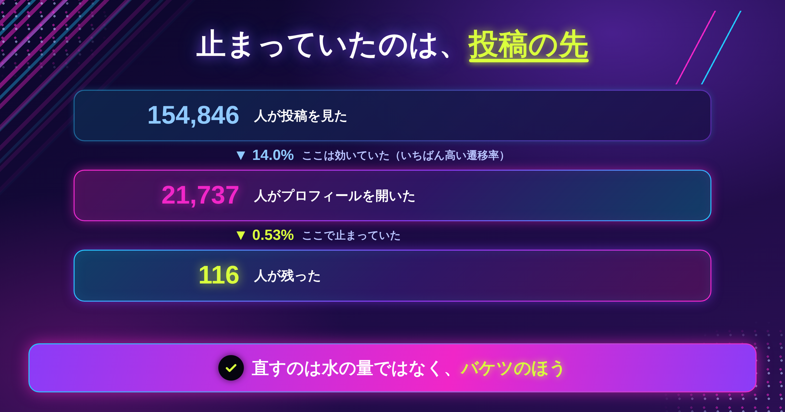
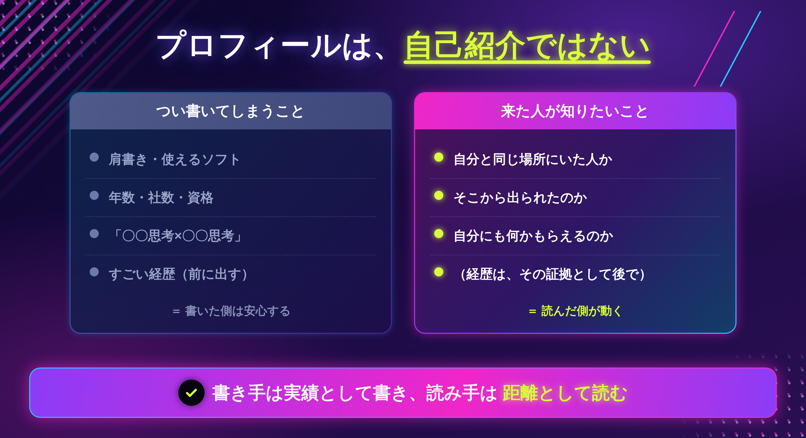
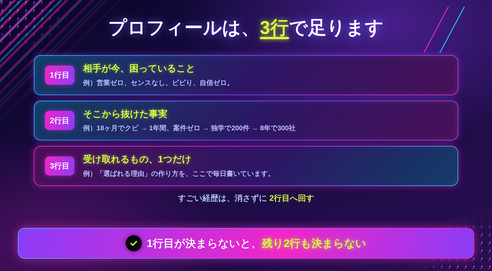
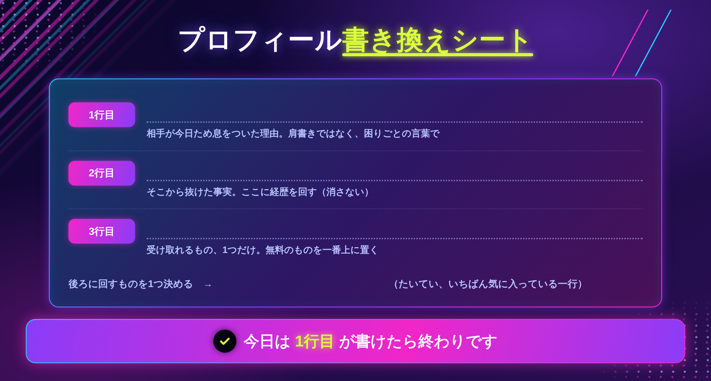

「プロフィール、何を書けばいいか分からないんです」

相談でよく聞きます。そして、たいていの方がこう続けます。

「とりあえず経歴は書いてあります」

私も、ずっとそうでした。6年ぶんの経歴を、できるだけ丁寧に書いていました。

先月、投稿の数字を調べていて、見たくないものを見ました。

ある投稿から、**21,737人がプロフィールを開いていました。** 15万回見られた投稿です。

そこから先に進んだ人は、**116人**でした。

**0.53%**です。

この記事に書くのは、**来てもらったあとに止まっている場所**と、プロフィールの直し方です。

投稿を増やす話ではありません。むしろ、**投稿はもう足りている**という話です。

## 投稿が当たっても、その先で止まります

### 数字で見ると、こうなっていました

```
　154,846人が投稿を見た
　　　↓　14.0%
　 21,737人がプロフィールを開いた
　　　↓　0.53%
　　　116人が残った
```

**投稿は効いていました。** 14%という遷移率は、私の投稿の中でもいちばん高いものです。

問題はそこではありませんでした。**2万1千人がお店の前まで来て、116人しか入らなかった**んです。

### 投稿を増やしても、ここは動きません

この数字を見るまで、私は「もっと伸びる投稿を書こう」と思っていました。

でも、仮に閲覧が2倍になっても、0.53%のままなら232人です。**穴が空いたバケツに、水を足しているのと同じ**でした。

直すのは、水の量ではなく、バケツのほうです。

> まずここだけ持ち帰ってください。**投稿が当たっているのに増えないなら、原因は投稿ではありません。**



## プロフィールは「自己紹介」ではありません

### 来た人が、どんな状態かを考えてみます

プロフィールを開いた2万1千人は、どういう人たちだったか。

**夫に「デザイナーなんか、もうやめたら？」と言われた夜の話を、最後まで読んだ人**です。

読んで、自分の何かを思い出して、「この人は、どうやってそこから出たんだろう」と思って開いた。そういう状態で来ています。

その人が知りたいのは、**私が何者か**ではありません。**自分がそこから出られるのか**です。

### 私のプロフィールが、何をしていたか

当時、こう書いていました。

```
〜デザイン思考×マーケ思考〜
雇われデザイナーを18ヶ月でクビ→1年無職→独学で200件→8年間で300社
営業ゼロ、センスなし、ビビり、自信ゼロでも仕事を取り続ける方法
トリリンガル・元社長秘書12年
個別相談はこちら
```

1行目が、抽象的な言葉でした。読んだ人の悩みの言葉が、ひとつも入っていません。

いちばん強い「営業ゼロ、センスなし、ビビり、自信ゼロでも」が、**3行目**にありました。

そして最後に、**トリリンガル・元社長秘書12年**。

事実です。嘘はありません。でも、読む人の側から読み直したとき、気づきました。

**共感で来た人を、最後の一行で突き放していた**んです。

> 今日のゴールは、自分のプロフィールを**読む人の立場で1回読む**ところまでで十分です。



ここまでが、何が起きていたかです。

では、何をどう書けばいいのか。**すごい経歴は、書いてはいけないのか。**

ここから、具体的な直し方を書きます。

## すごい経歴ほど、距離を作ります

結論から言うと、**経歴は消さなくていいです。置く場所を変えます。**

経歴を書くと、書いた側は安心します。嘘がないからです。だから、つい前に出したくなります。

でも、読む人はこう受け取ります。

```
「トリリンガル」　　　　 → この人は、私とは違う人だ
「元社長秘書12年」　　　 → もともと優秀だったんだ
「8年で300社」　　　　  → 私には遠い話だ
```

**書き手は実績として書き、読み手は距離として読みます。**

6年かけて「私もあなたと同じでした」と伝えてきたものが、この3行でひっくり返っていました。

### 置く順番だけ変えます

経歴を消す必要はありません。**後ろに回すだけ**です。

先に「あなたと同じでした」を置いて、そのあとに経歴が来ると、同じ一行が**「そこから出た証拠」**として読まれます。

順番が違うだけで、意味が変わります。

## プロフィールの3行

長く書く必要はありません。**3行で足ります。**

```
1行目｜相手が今、困っていること
2行目｜そこから抜けた事実
3行目｜受け取れるもの、1つだけ
```

私の場合は、こうなりました。

```
営業ゼロ、センスなし、ビビり、自信ゼロ。
それでも選ばれる方法はありました。

雇われデザイナーを18ヶ月でクビ → 1年間、案件ゼロ
→ 独学で200件 → 8年で300社

「選ばれる理由」の作り方を、ここで毎日書いています。
```

経歴は消していません。**1行目と入れ替えただけ**です。



### 1行目が、いちばん大事です

ここが決まらないと、残り2行も決まりません。

1行目に書くのは、**自分の肩書きではなく、相手が今日ため息をついた理由**です。

```
× Webデザイナー｜LP制作が得意です
○ 応募しても返事が来ない。ポートフォリオは直したのに。
```

後ろのほうが、読んだ人は「私のことだ」と思います。

## 出口は、1つだけにする

もうひとつ、私が間違えていたところがあります。

プロフィールの最後に、**「個別相談はこちら」しか置いていませんでした。**

### 2万1千人のうち、今日相談したい人は何人か

ほとんどいません。たぶん、1%もいないと思います。

読んだ直後の人は、「この人の話をもう少し聞いてみたい」くらいの温度です。そこへ**いちばん重い扉**だけを置いていたら、残りの人は何もできないまま帰ります。

階段が、1段目から3段目に飛んでいました。

### 無料の受け皿を、先に置く

だから今は、こうしています。

```
1段目｜無料で受け取れるもの（ここを一番上に）
2段目｜個別相談の詳細
3段目｜note
```

**出口は1つに見えるように、いちばん上だけを目立たせます。** 並べすぎると、どれも選ばれません。

> 全部そろえなくて大丈夫です。無料の受け皿が1つあれば、それで足ります。

## 実際に書き換える（15分）

### ステップ1｜今のプロフィールを、声に出して読む（3分）

自分で書いた文章は、目で読むと素通りします。**声に出す**と、引っかかるところが分かります。

引っかかったら、そこが相手も引っかかっているところです。

### ステップ2｜3行に入れ直す（10分）



1行目から書いてください。3行目から埋めようとすると、たいてい詰まります。

### ステップ3｜後ろに回すものを決める（2分）

消すのではなく、**後ろに回すもの**を1つ選びます。たいていは、いちばん自分が気に入っている一行です。

私の場合は「トリリンガル・元社長秘書12年」でした。

### 書けないときの、3つの分かれ道

**①1行目に、自分の肩書きしか浮かばない**

まだ「誰の」が決まっていません。直近で相談を受けた人、または**6年前の自分**を1人思い浮かべて、その人が今日ため息をついた理由を書いてください。

**②経歴を消すのが怖い**

消さなくていいです。**順番を変えるだけ**です。消すのではなく、2行目に回してください。

**③何を無料で渡せばいいか分からない**

新しく作らなくて大丈夫です。**すでに書いた記事や投稿の中から、いちばん反応がよかったもの1つ**で足ります。「あの話をまとめたものを渡します」で成立します。

> 今日は1行目が書けたら終わりで大丈夫です。3行そろえなくていいです。

## おわりに

2万1千人がプロフィールを開いて、116人しか残らなかった。

あのとき私が手を入れようとしていたのは、投稿のほうでした。もっと伸びる投稿を書けば、もっと増えるはずだと思っていました。

でも、投稿はもう効いていました。**止まっていたのは、来てもらったあとの場所**でした。

もし今、「毎日書いているのに増えない」と感じているなら、投稿を1本増やす前に、**自分のプロフィールを声に出して読んでみてください。**

たぶん、直すところはそっちにあります。

---

「自分のプロフィールの、どこを直せばいいのか分からない」という方へ。

LINEで、個別ロードマップ作成会をご案内しています。今の文面を一緒に見ながら、直す1行を決めます。よかったら覗いてみてください。
