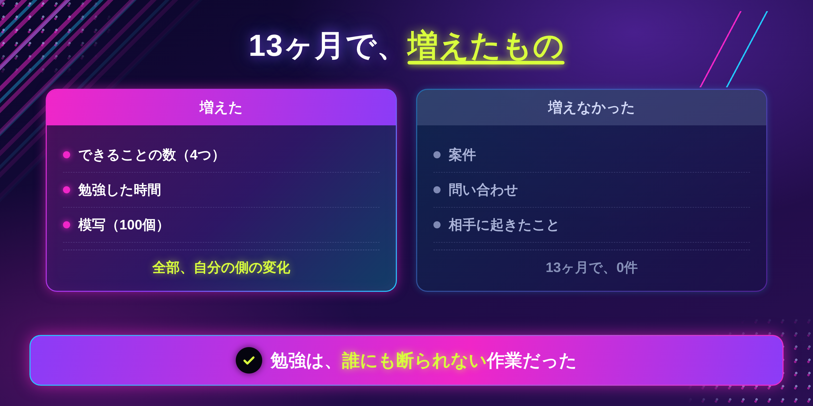
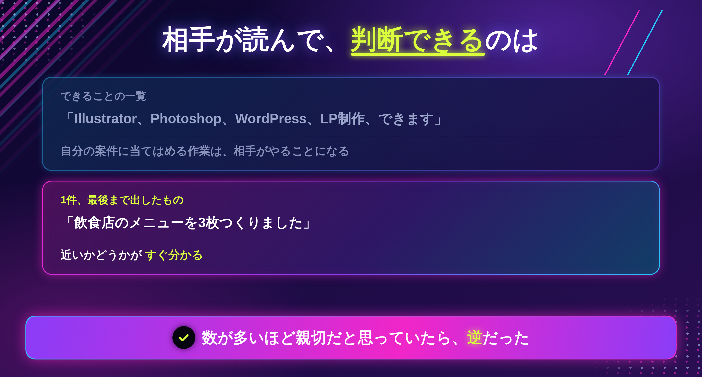
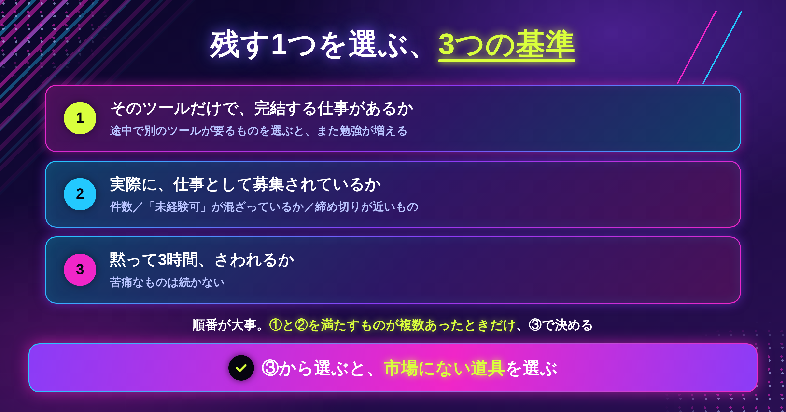
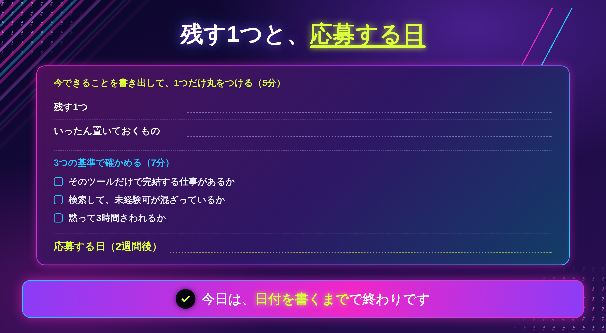

「もう少し自信がついたら、応募します」

よく聞く言葉です。そして、13ヶ月のあいだ、私がずっと言っていた言葉でもあります。

その13ヶ月で、私がやっていたことです。

```
夜間スクールを2つ出る
模写を100個つくる
Illustrator を覚える
Photoshop を覚える
WordPress を覚える
LPの作り方を覚える
```

できることは、たしかに増えました。

**案件は、0件でした。**

そして今、8年たって仕事で使っているツールは、**3つだけ**です。

増やしたぶんの多くは、使っていません。

## 増えたのは、「できることの数」だけでした

当時の私は、できることが増えれば、そのぶん選ばれる確率が上がると思っていました。

4つできれば、1つの人より4倍チャンスがあるはずだと。

実際は、こうでした。

```
増えた　　　できることの数
増えた　　　勉強した時間
増えない　　案件
増えない　　問い合わせ
```

勉強をしているあいだは、前に進んでいる感じがします。覚えたことが目に見えるからです。

ただ、**それは全部、自分の側の変化**でした。相手には、何も起きていません。

そして勉強には、都合のいいところがあります。**誰にも断られない**んです。

応募すれば落ちます。営業すれば返事が来ません。でも勉強は、やったぶんだけ進みます。だから私は、いちばん安全な作業を13ヶ月続けていました。



## 「全部できます」は、何もできないと同じに見えます

あとから、人を探す側にもまわりました。そこで分かったことがあります。

**相手は「何でもできる人」を探していません。**

探しているのは、**自分の案件に近いことを、やったことがある人**です。

```
×  Illustrator、Photoshop、WordPress、LP制作、できます
○  飲食店のメニューを3枚つくりました
```

上は、できることの一覧です。読んだ相手は、自分の案件に当てはめる作業を自分でやることになります。

下は、1つだけです。でも、**自分の案件に近いかどうかが、すぐ分かります。**

判断に使えるのは、後者だけでした。数が多いほど親切だと思っていましたが、逆でした。

### 中途半端に4つより、1つで事例がある人

厳しい書き方になりますが、4つを浅く覚えた状態は、相手から見ると**どれも頼めない**のと同じに見えます。

「できます」と「任せられます」のあいだには、距離があります。その距離を埋めるのは、ツールの数ではありませんでした。

埋めていたのは、**1件でも、最後まで出したことがあるかどうか**でした。

4つを浅く触った13ヶ月より、1つで1枚仕上げた1日のほうが、相手に見せられるものが多かったんです。

### 今日、無料でできること

紙でもメモでも構いません。**今できることを、全部書き出してください。**

ツールの名前でも、作ったものでも、どちらでもいいです。

書き終わったら、**1つだけ丸をつけます。**

選ぶ基準は、いまは「いちばん長く触っているもの」で構いません。うまい・下手は関係ありません。

残りに×をつける必要はないです。**捨てるのではなく、いったん置いておくだけ**です。ここを「捨てる」と考えると、だいたい決められなくなります。私もそうでした。



> 今日はここまでで十分です。丸をつけるだけです。

ここまでが、数を増やしても変わらなかった、という話です。

ただ、「1つに絞る」と言われても、**どれを残すか**で止まると思います。私も、捨てるのが怖くて決められませんでした。

この先に書くのは、**残す1つの選び方（3つの基準）**と、次に取る案件のレベルの決め方、そして勉強をやめる日の決め方です。

## 残す1つは、3つの基準で選びます

好きかどうかでは決めません。順番に見ていきます。

### 基準①｜そのツールだけで、完結する仕事があるか

いちばん大事なのがこれです。

そのツール1つで、**最初から最後まで終わる仕事**があるかどうか。

```
○  Canva だけ　→　SNS投稿画像、簡単なチラシ
○  Photoshop だけ　→　バナー、商品画像の加工
○  Figma だけ　→　LPやサイトのデザインデータ
△  Illustrator だけ　→　ロゴは作れるが、使う場面が分かれる
```

途中で別のツールが必要になるものを選ぶと、結局また勉強が増えます。

### 基準②｜実際に、仕事として募集されているか

相場の表は出しません。**自分で見たほうが早い**からです。

クラウドソーシングのサイトを開いて、ツール名で検索してください。

```
1｜案件の件数が、何件あるか
2｜「未経験可」「初めての方歓迎」が混ざっているか
3｜締め切りが近いものが、いくつあるか
```

件数が多くても、全部が大手案件なら今は届きません。**未経験可が混ざっているか**を見てください。

### 基準③｜自分が、黙って3時間さわれるか

これは感覚の話ですが、外せません。

3時間さわって、苦痛でないかどうか。苦痛なものは、続きません。

**①と②を満たすものが複数あったときだけ、③で決めます。** 最初から③で選ぶと、市場にない道具を選んでしまいます。



## 次に取るのは、「今の実力＋少し」の案件です

絞ったあと、次に迷うのが案件のレベルです。

完璧にできるようになってから応募しよう、と思うと、永遠に応募できません。私がそうでした。

目安は、**今できることの、少し上**です。

```
今：バナーが作れる　　　→　次：LPの一部を担当する
今：LPが作れる　　　　 →　次：サイトを1ページ
今：サイトが作れる　　 →　次：UIの一部を担当する
```

### 締め切りがあると、できるようになります

初めてWebサイトの案件を受けたとき、正直、できる自信はありませんでした。

でも締め切りがあるので、必死で調べて、なんとか納品しました。そこで学んだことは、独学の3ヶ月ぶんに近かったと思います。

勉強が足りないから動けないのではなく、**動かないから勉強が終わらない**状態でした。

### ただし、できない部分は、黙らないでください

ここだけ、はっきり書きます。

「できない部分は言わずに受ける」という進め方を見かけます。**やらないでください。**

受けた時点では隠せても、納品のときに必ず出ます。そのとき失うのは、1件の仕事ではなく、相手からの信頼です。

代わりに、**範囲を書いて受けてください。**

```
今回は、デザインデータの作成までを担当します。
サーバーへの設置は、含まれていません。

LPのデザインは可能です。
コーディングは今回は範囲外になります。
```

これを書いても、断られませんでした。むしろ、**どこまで頼めるかが分かるので、相手は決めやすくなります。**

できないことを言うのと、できる範囲を書くのは、別のことです。

## 勉強をやめる日を、先に決めます

最後に、いちばん効いたことを書きます。

**応募する日を、先にカレンダーに書く**ことです。

私は、それをしていませんでした。だから「もう少し」が13ヶ月続きました。

```
×  できるようになったら応募する
○  ◯月◯日に応募する。それまでにできる範囲でやる
```

日付を決めると、やることが変わります。全部覚えようとするのをやめて、**その日までに1件ぶん出せる形**を作るようになります。

おすすめは、**2週間後**です。1ヶ月だと、また後ろにずれます。

## 実際にやってみる（15分）



### ステップ1｜できることを書き出して、1つ丸をつける（5分）

無料部分でやったところです。まだなら、ここでやってください。

### ステップ2｜3つの基準で、確かめる（7分）

丸をつけた1つを、上の①②③に当てはめます。

②でクラウドソーシングを開くところまでやってください。**件数を数えるだけ**で構いません。

①が×だったときは、2番目に長く触っているものに変えます。

### ステップ3｜応募する日を決める（3分）

2週間後の日付を、カレンダーに書きます。

書いたら今日は終わりです。何も作らなくて大丈夫です。

### 決められないときの、3つの分かれ道

**① どれも同じくらいしか触っていない**

いちばん**最近さわったもの**にしてください。記憶が残っているぶん、立ち上がりが速くなります。

**② 絞ると、仕事の幅が狭くなりそうで怖い**

狭くなります。ただ、狭いほうが見つけてもらえます。幅は、1件目が決まったあとに広げれば足ります。順番の問題です。

**③ 検索しても、未経験可の案件がない**

ツールを変える前に、**検索するサイトを変えてください。** 1つのサイトだけで判断すると、そのサイトの傾向を市場だと思い込みます。

> 今日は、1つに丸をつけて、日付を書くところまでで大丈夫です。

## おわりに

13ヶ月、私は勉強していました。ツールは4つ覚えました。案件は0件でした。

今、仕事で使っているのは3つです。増やした時間のうち、どれだけが必要だったのかは分かりません。

ただ、**案件が決まり始めたのは、増やすのをやめてからでした。**

もし今、「もう少し自信がついたら」と思っているなら、その「もう少し」がいつ終わるのか、一度だけ日付にしてみてください。

たぶん、終わらないまま伸びます。私がそうでした。

---

「どれを残せばいいのか、自分では決められない」という方へ。

LINEで、個別ロードマップ作成会をご案内しています。今できることを一緒に並べて、残す1つと、応募する日を決めます。よかったら覗いてみてください。
